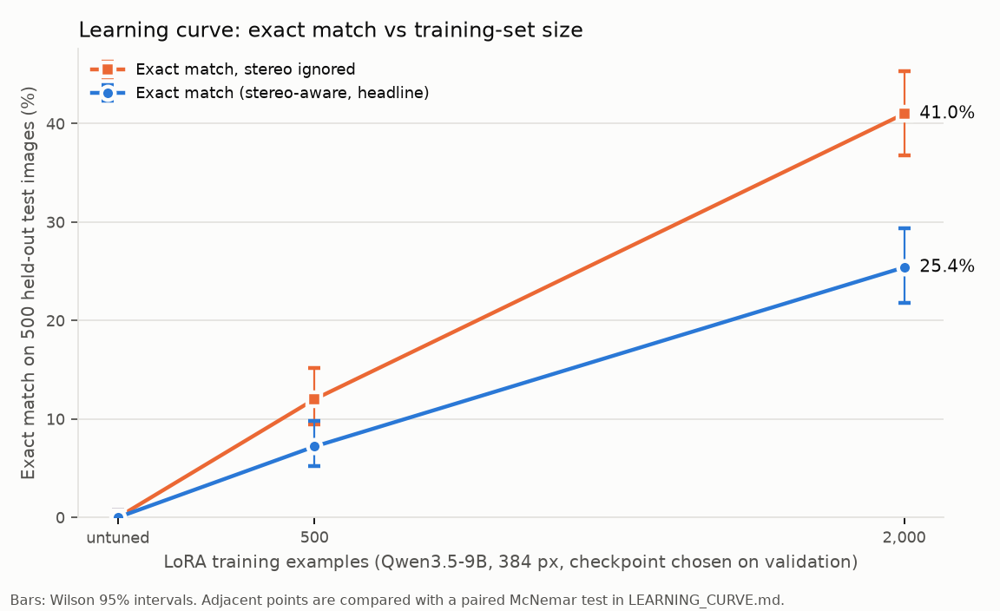

# Learning curve and ablations (Person A)

Qwen3.5-9B + LoRA (rank 8; language-model MLP + full attention unless noted), 3 epochs, batch 8, LR 2e-4 cosine, thinking off, temperature 0, max_tokens 108. Trained and served on Modal (1x L40S, vLLM). Nested training subsets (first N rows of the shuffled train manifest). Every run saves one checkpoint per epoch; the reported checkpoint is chosen on the 200-image **validation** set (highest stereo-aware exact match; ties: lower validation loss, then earlier epoch). The 500-image test set is scored once per chosen checkpoint and never used for selection. Headline metric (pre-registered): stereo-aware exact match.

## Learning curve (test_synthetic_384, 500 images)

| Train size | Checkpoint | Exact [95% CI] | Exact, stereo ignored [95% CI] | Valid | Tanimoto | Loops | Tokens in/out | Latency med / p95 | Steady $/1k images | vs previous size (McNemar) |
|---|---|---|---|---|---|---|---|---|---|---|
| untuned | `untuned` | 0.0% (0/500) [0.0%–0.8%] | 0.0% [0.0%–0.8%] | 66.4% | 0.11 | 21.4% | 175 / 64 | 1.82 s / 3.31 s | $0.138 @ 8 conc. | – |
| 500 | `n500_r384_lang_e3` | 7.2% (36/500) [5.2%–9.8%] | 12.0% [9.4%–15.1%] | 73.6% | 0.42 | 0.0% | 175 / 33 | 1.26 s / 1.88 s | $0.089 @ 8 conc. | +36 / -0 images, p=<0.001 |
| 2,000 | `n2000_r384_lang_e3_ep3` | 25.4% (127/500) [21.8%–29.4%] | 41.0% [36.8%–45.4%] | 87.8% | 0.69 | 0.0% | 175 / 32 | 1.23 s / 1.78 s | $0.086 @ 8 conc. | +98 / -7 images, p=<0.001 |

The 500 run predates per-epoch checkpoints, so its final (epoch-3) adapter is reported; its validation loss was 0.353 at epoch 2 vs 0.363 at epoch 3.

Latency is per request at the stated concurrency; compare rows measured in the same server session. Steady $/1k excludes the one-off cold start (see each results file's `cold_start_s`). Checkpoint choices: `selection.json`. Costs per run: `cost_log.md`.
